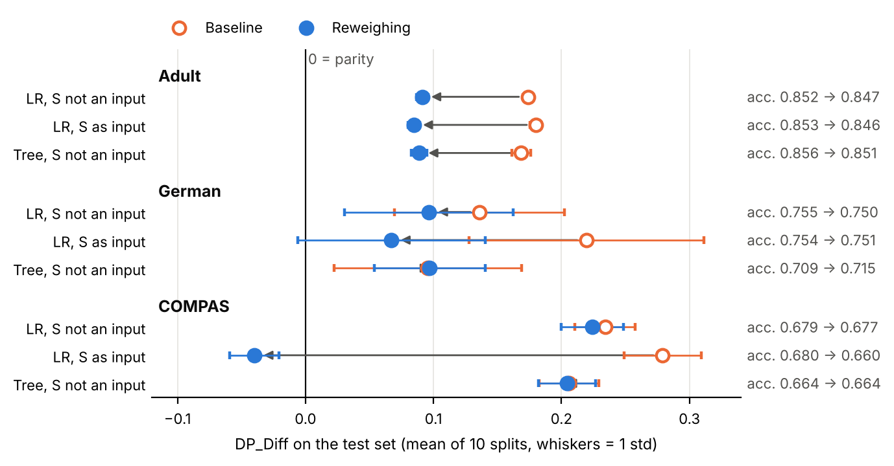

# Reweighing on Adult, German Credit and COMPAS

Assignment 4 (Paper Review and Algorithm Evaluation, Algorithmic Fairness) for Data Wrangling (INFOMDW), Utrecht University.

This repository evaluates **Reweighing**, the pre-processing bias-mitigation algorithm of

> F. Kamiran and T. Calders (2012). Data preprocessing techniques for classification without discrimination. *Knowledge and Information Systems* 33(1), 1-33. https://doi.org/10.1007/s10115-011-0463-8

on three public datasets. Reweighing gives each training row a weight that makes the sensitive attribute and the label independent in the weighted training set. A standard classifier then trains with these weights.

## Contents

| Path | Content |
|---|---|
| `reweighing_evaluation.ipynb` | The full pipeline, executed, with all outputs saved |
| `data/` | The three datasets, unchanged from their sources |
| `results/` | Tables (CSV) and the figure that the notebook writes |
| `requirements.txt` | Python packages |

## Reproduce the results

1. Install Python 3.10 or newer.
2. Get the code and enter the folder:
   ```bash
   git clone <URL of this repository>
   cd reweighing-fairness-evaluation
   ```
3. Create an environment and install the packages:
   ```bash
   python -m venv .venv
   source .venv/bin/activate        # Windows: .venv\Scripts\activate
   pip install -r requirements.txt
   ```
4. Run the notebook from the repository root, so that `data/` and `results/` resolve:
   ```bash
   jupyter nbconvert --to notebook --execute --inplace reweighing_evaluation.ipynb
   ```
   Alternative: `jupyter notebook`, open `reweighing_evaluation.ipynb`, then `Kernel > Restart & Run All`.
5. The run takes about one minute. It rewrites every file in `results/` and the outputs inside the notebook.

No download step is needed: the data files are in `data/`. No GPU and no internet connection are needed.

## Parameters

Reweighing has no parameters. All other settings sit in the first code cell of the notebook.

| Parameter | Value | Meaning |
|---|---|---|
| `SEED` | 42 | Seed of the main train/test split |
| `TEST_SIZE` | 0.30 | Share of rows held out for testing |
| Stratification | `2 * s + y` | The split keeps the four combinations of group and label in proportion |
| `K_NEIGHBOURS` | 5 | Neighbours in the consistency measure |
| `N_REPEATS` | 10 | Further splits (seeds 0 to 9) for the robustness check |
| Logistic regression | `C=1.0`, `solver="lbfgs"`, `max_iter=5000` | Main classifier |
| Decision tree | `min_samples_leaf=20`, `random_state=0` | Second classifier in the robustness check |

## Datasets

| Dataset | Files in `data/` | Rows used | Sensitive attribute `s` | Privileged group | Favourable outcome `y = 1` |
|---|---|---|---|---|---|
| Adult (Census Income) | `adult.data`, `adult.test` | 48,842 | sex | Male | income > 50K |
| German Credit (Statlog) | `german.data` | 1,000 | age | older than 25 | good credit risk |
| COMPAS | `compas-scores-two-years.csv` | 5,278 | race | Caucasian | no re-offence within two years |

Sources:

* Adult: UCI Machine Learning Repository, https://archive.ics.uci.edu/dataset/2/adult
* German Credit: UCI Machine Learning Repository, https://archive.ics.uci.edu/dataset/144/statlog+german+credit+data
* COMPAS: ProPublica, https://github.com/propublica/compas-analysis

Preparation inside the notebook:

* Adult: `adult.data` and `adult.test` together, as in the paper. `fnlwgt` and `education` dropped. Missing values (`?`) stay as a category of their own.
* German: age enters the analysis through the binary sensitive attribute alone.
* COMPAS: ProPublica's row filters, African-American and Caucasian defendants, seven features (age, sex, priors count, three juvenile counts, charge degree).
* Categorical features are one-hot encoded. Features are standardised with statistics from the training set.

## Method

1. **Original labels.** DP_Diff, DIR and consistency of the labels of each full dataset.
2. **Split.** 70 % train, 30 % test, stratified.
3. **Reweighing.** `W(s, y) = P(S = s) * P(Y = y) / P(S = s, Y = y)`, computed on the training set (Algorithm 3 of the paper). The implementation is the function `reweighing_weights` in the notebook. Two checks run inside the notebook: the function returns the weights of the paper's Example 3 (1.5, 0.67, 0.75, 2), and the weighted training set has DP_Diff = 0 in every run.
4. **Training.** A baseline model without weights and a mitigated model with the weights as `sample_weight`.
5. **Test set.** DP_Diff, DIR, consistency, accuracy and balanced accuracy of both models.
6. **Comparison** of the measures before and after mitigation.

Measures (definitions of the course slides, G' privileged, G unprivileged):

* `DP_Diff = P(Y = 1 | G') - P(Y = 1 | G)`, optimal value 0
* `DIR = P(Y = 1 | G) / P(Y = 1 | G')`, optimal value 1
* `Consistency = 1 - mean | y_i - mean of y over the k nearest neighbours of x_i |`, optimal value 1, k = 5, neighbours found on the standardised non-sensitive features, the row itself included

Two scenarios follow the paper: the sensitive attribute is not a model input (primary), and the sensitive attribute is a model input.

## Main results (test set, seed 42, logistic regression)

| Dataset | Scenario | Stage | DP_Diff | DIR | Consistency | Accuracy |
|---|---|---|---|---|---|---|
| Adult | full dataset | Original labels | 0.195 | 0.360 | 0.835 | |
| Adult | S not an input | Baseline | 0.172 | 0.319 | 0.949 | 0.852 |
| Adult | S not an input | Reweighing | 0.089 | 0.580 | 0.950 | 0.847 |
| Adult | S as input | Baseline | 0.177 | 0.305 | 0.948 | 0.852 |
| Adult | S as input | Reweighing | 0.081 | 0.614 | 0.950 | 0.846 |
| German | full dataset | Original labels | 0.149 | 0.795 | 0.737 | |
| German | S not an input | Baseline | 0.107 | 0.873 | 0.843 | 0.770 |
| German | S not an input | Reweighing | 0.076 | 0.911 | 0.847 | 0.780 |
| German | S as input | Baseline | 0.150 | 0.824 | 0.854 | 0.770 |
| German | S as input | Reweighing | 0.037 | 0.957 | 0.843 | 0.777 |
| COMPAS | full dataset | Original labels | 0.132 | 0.783 | 0.651 | |
| COMPAS | S not an input | Baseline | 0.255 | 0.659 | 0.980 | 0.667 |
| COMPAS | S not an input | Reweighing | 0.249 | 0.670 | 0.979 | 0.667 |
| COMPAS | S as input | Baseline | 0.280 | 0.633 | 0.973 | 0.669 |
| COMPAS | S as input | Reweighing | -0.055 | 1.097 | 0.879 | 0.640 |

The same numbers are in `results/table5_before_after.csv`. `results/table4_repeats_mean_std.csv` holds the mean and standard deviation over ten further splits, and `results/figure_dp_diff_before_after.png` shows them.



## Files in `results/`

| File | Content |
|---|---|
| `table0_datasets.csv` | Rows, encoded features and group sizes |
| `table1_original_labels.csv` | Fairness measures of the original labels |
| `table2_reweighing_weights.csv` | The four Reweighing weights for each dataset |
| `table3_test_results_seed42.csv` | Test-set measures of the main split |
| `table4_repeats_mean_std.csv` | Mean and standard deviation over seeds 0 to 9 |
| `table5_before_after.csv` | Before and after comparison |
| `table6_proxy_auc.csv` | How well the non-sensitive features predict the sensitive attribute |
| `repeats_all_seeds.csv` | Every run of the robustness check |
| `figure_dp_diff_before_after.png` / `.pdf` | Figure of the report |

## Environment of the committed run

Python 3.13.18, NumPy 2.5.3, pandas 3.0.5, scikit-learn 1.9.1, matplotlib 3.11.2. Other versions can change the third decimal of some values.
